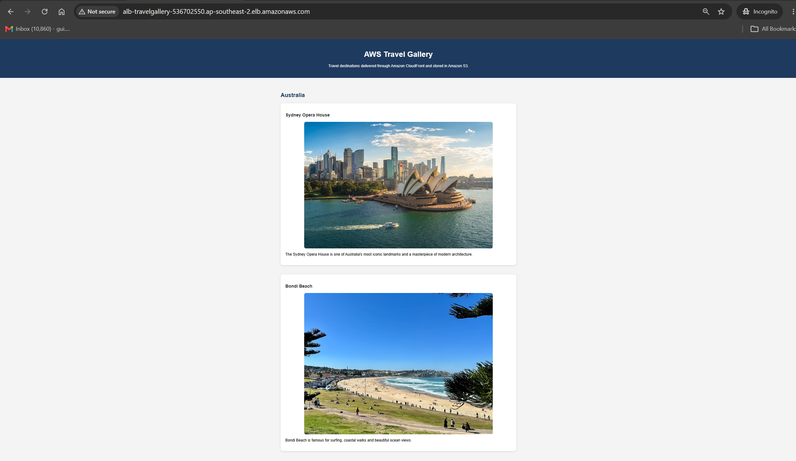
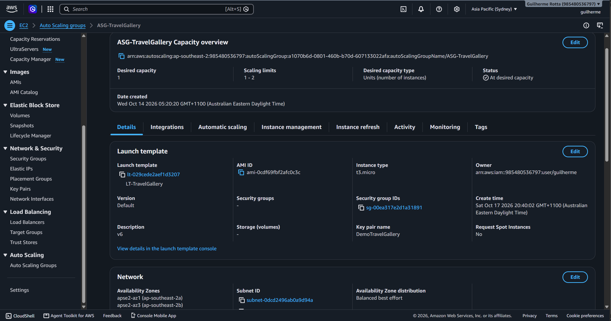
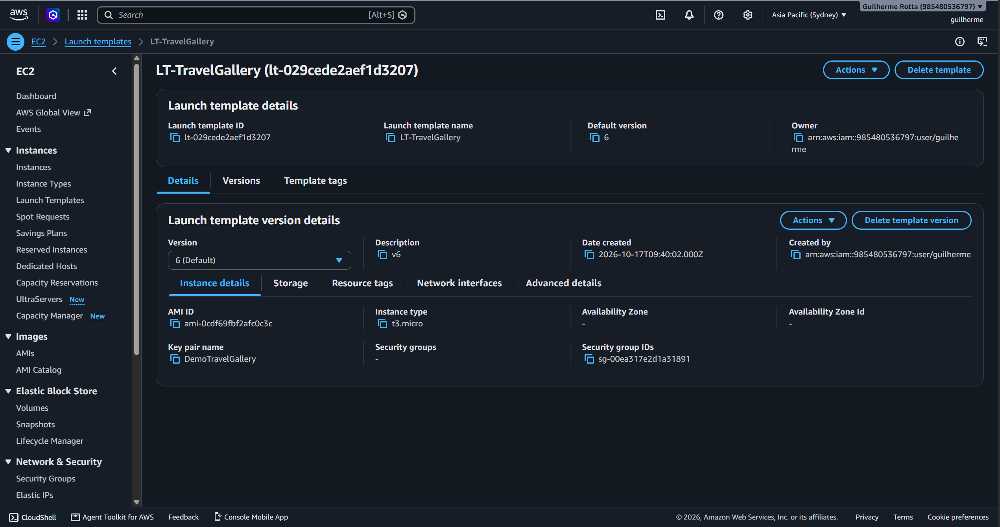
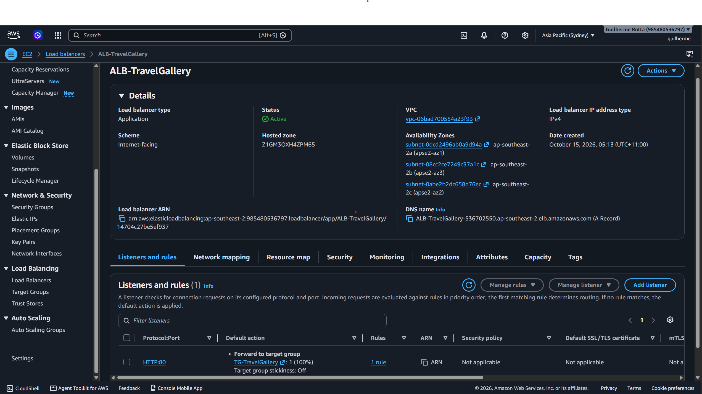
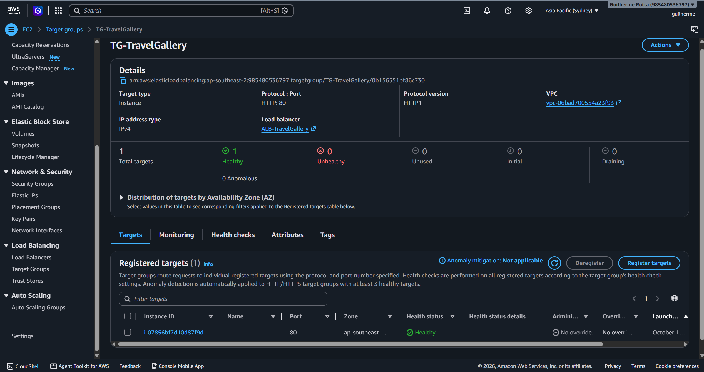
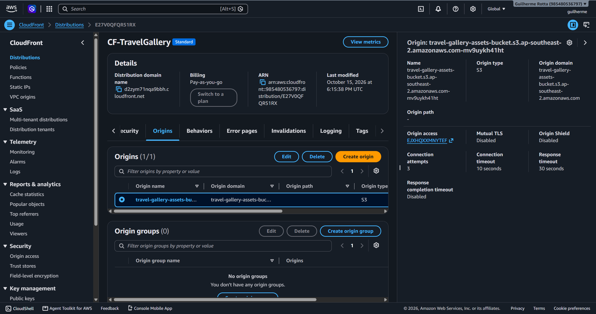
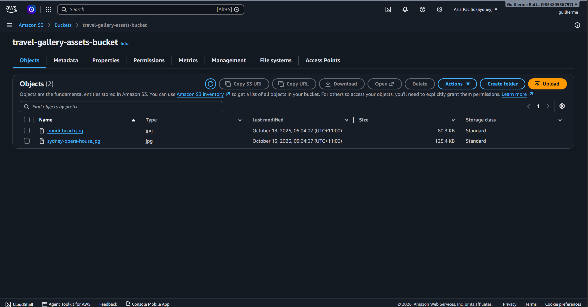
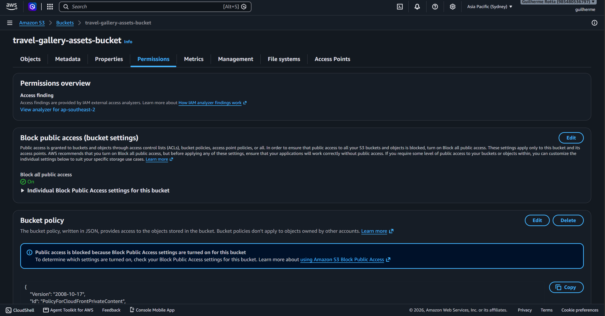
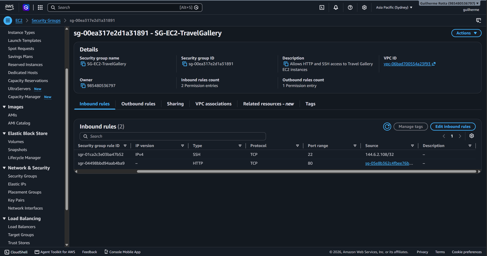

# AWS Travel Gallery

## Project Overview

AWS Travel Gallery is a highly available web application hosted on AWS that demonstrates load balancing, auto scaling, automated recovery, secure content delivery, and private object storage.

The application runs on Amazon EC2 instances managed by an Auto Scaling Group (ASG) and distributed through an Application Load Balancer (ALB). Static image assets are stored in a private Amazon S3 bucket and delivered securely through Amazon CloudFront.

This project was designed to demonstrate core AWS infrastructure concepts commonly used in production environments.

---

## Final Application

The application displays travel destinations while serving image assets through Amazon CloudFront from a private Amazon S3 bucket.



### Architecture

```text
Internet
    |
    v
Application Load Balancer
    |
    v
Target Group
    |
    v
Auto Scaling Group
    |
    v
EC2 Instance

CloudFront
    |
    v
Private S3 Bucket
```

---

## AWS Services Used

### Compute

- Amazon EC2
- Amazon Auto Scaling Group
- Launch Templates

### Networking

- Application Load Balancer
- Target Groups
- Security Groups

### Storage and Content Delivery

- Amazon S3
- Amazon CloudFront

---

## Key Features

### High Availability

The application is deployed behind an Application Load Balancer and managed by an Auto Scaling Group to ensure availability and resilience.

### Auto Healing

If an EC2 instance becomes unhealthy or is terminated, the Auto Scaling Group automatically launches a replacement instance.

### Centralized Configuration

Launch Templates provide consistent EC2 deployment settings and automate application installation through User Data scripts.

### Secure Traffic Flow

The EC2 instance accepts HTTP traffic only from the Application Load Balancer Security Group.

### Private Object Storage

Image assets are stored in a private S3 bucket protected by Block Public Access.

### Content Delivery Network

CloudFront distributes content globally while keeping the S3 bucket private.

---

## Infrastructure Screenshots

### Auto Scaling Group



The Auto Scaling Group maintains application availability and automatically replaces unhealthy instances.

### Launch Template



Launch Templates provide reusable EC2 configuration and automated deployment settings.

### Application Load Balancer



The Application Load Balancer distributes incoming traffic across healthy targets.

### Target Group Health Checks



Target Group health checks ensure only healthy instances receive application traffic.

### CloudFront Origin Configuration



CloudFront is configured to use Amazon S3 as its origin, allowing secure and efficient delivery of static assets.

### Amazon S3 Objects



The S3 bucket stores the image assets used by the application.

### Private S3 Bucket Configuration



Block Public Access is enabled to ensure that objects cannot be accessed directly from the internet.

### Security Group Configuration



Security Groups restrict traffic by allowing HTTP access only from the Application Load Balancer Security Group and SSH access from a trusted IP address.

---

## Security Controls

The following security measures were implemented:

- Block Public Access enabled on Amazon S3
- EC2 instances protected behind an Application Load Balancer
- HTTP access restricted to the ALB Security Group
- SSH access restricted to a trusted IP address
- CloudFront integrated with a private S3 bucket

---

## Lessons Learned

During this project I gained practical experience with:

- Launch Template version management
- EC2 User Data automation
- Auto Scaling Group configuration
- Application Load Balancer setup
- Target Group health checks
- CloudFront distributions
- Private Amazon S3 buckets
- Security Group implementation
- Auto healing infrastructure
- AWS troubleshooting and debugging

---

## Future Improvements

Potential future enhancements include:

- Route 53 custom domain integration
- HTTPS implementation with AWS Certificate Manager (ACM)
- Infrastructure as Code (Terraform)
- Monitoring with Amazon CloudWatch
- CI/CD pipelines using GitHub Actions and AWS services

---

## Author

**Guilherme Rotta**

AWS Cloud Engineering Portfolio Project

---

## Built Using

- Amazon EC2
- Auto Scaling Groups
- Application Load Balancer
- Launch Templates
- Amazon CloudFront
- Amazon S3
- Security Groups
- Target Groups